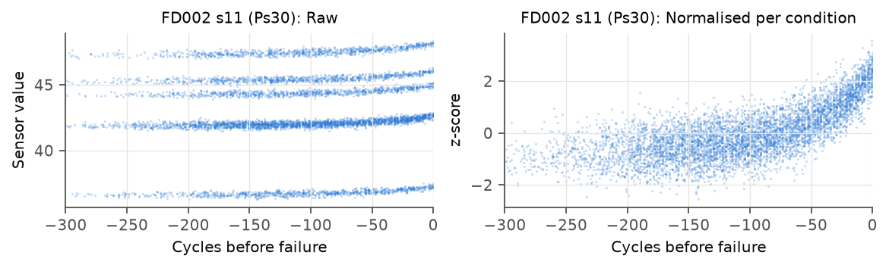
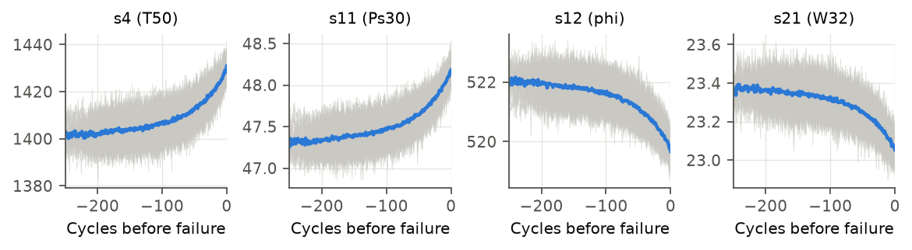
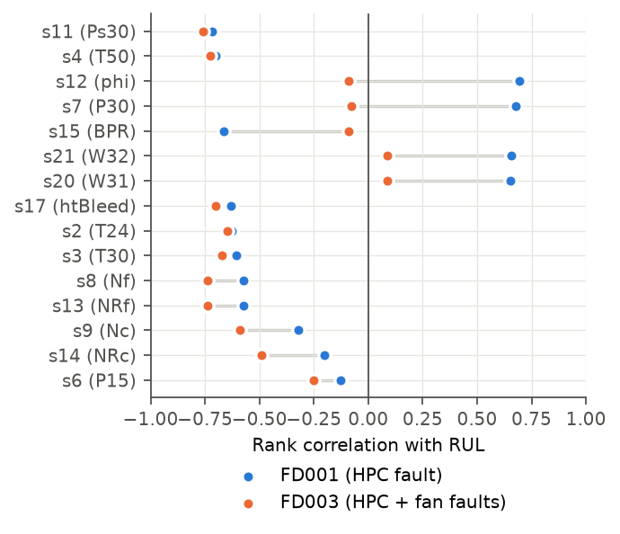
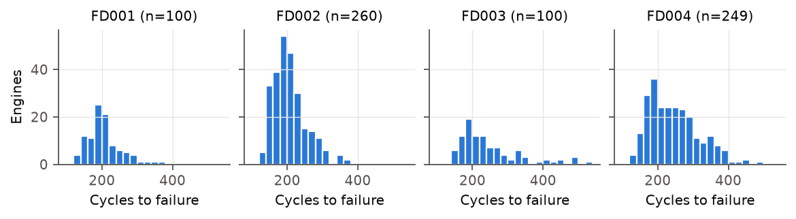

# Data card: NASA C-MAPSS turbofan engine degradation

| | |
|---|---|
| **Source** | NASA Ames Prognostics Center of Excellence (PCoE) data repository |
| **Download** | `python -m mindtwin.data.cmapss download` (archive SHA-256 verified) |
| **Archive SHA-256** | `c9c5dec12a945a82e8bb4446589d7fb3cc057b5e5d81fa1a12e25ee9912ad3b2` |
| **Reference** | Saxena, Goebel, Simon, Eklund (2008). *Damage propagation modeling for aircraft engine run-to-failure simulation.* PHM08 |
| **Type** | Simulated (C-MAPSS simulator), multivariate time series, run-to-failure |
| **Use in mindtwin** | Primary use case: twin state, degradation, RUL, fault reasoning, TwinQA questions |

## Contents

Each row is one operating cycle of one engine: `unit, cycle, setting1–3, s1–s21` (26 columns).
Every engine starts healthy with unknown initial wear and develops a fault. Training engines run
until failure; test engines stop some time before failure, and `RUL_FDxxx.txt` gives the true
remaining life at their last cycle. Sensor data contains noise.

| Subset | Conditions | Fault modes | Train engines | Test engines | Train rows | Test rows | Life (min / median / max cycles) | Test RUL range |
|---|---|---|---|---|---|---|---|---|
| FD001 | 1 | HPC | 100 | 100 | 20,631 | 13,096 | 128 / 199 / 362 | 7–145 |
| FD002 | 6 | HPC | 260 | 259 | 53,759 | 33,991 | 128 / 199 / 378 | 6–194 |
| FD003 | 1 | HPC, fan | 100 | 100 | 24,720 | 16,596 | 145 / 220 / 525 | 6–145 |
| FD004 | 6 | HPC, fan | 249 | 248 | 61,249 | 41,214 | 128 / 234 / 543 | 6–195 |

Numbers computed by `experiments/eda/cmapss_eda.py` (see `experiments/results/eda/summary.json`).

> **Erratum in the official readme.** It lists FD004 as 248 train / 249 test engines. The files
> contain **249 train / 248 test**. mindtwin uses the counts from the files.

## Sensors

| Col | Name | Meaning | Unit |
|---|---|---|---|
| s1 | T2 | Total temperature at fan inlet | °R |
| s2 | T24 | Total temperature at LPC outlet | °R |
| s3 | T30 | Total temperature at HPC outlet | °R |
| s4 | T50 | Total temperature at LPT outlet | °R |
| s5 | P2 | Pressure at fan inlet | psia |
| s6 | P15 | Total pressure in bypass duct | psia |
| s7 | P30 | Total pressure at HPC outlet | psia |
| s8 | Nf | Physical fan speed | rpm |
| s9 | Nc | Physical core speed | rpm |
| s10 | epr | Engine pressure ratio (P50/P2) | – |
| s11 | Ps30 | Static pressure at HPC outlet | psia |
| s12 | phi | Ratio of fuel flow to Ps30 | pps/psi |
| s13 | NRf | Corrected fan speed | rpm |
| s14 | NRc | Corrected core speed | rpm |
| s15 | BPR | Bypass ratio | – |
| s16 | farB | Burner fuel-air ratio | – |
| s17 | htBleed | Bleed enthalpy | – |
| s18 | Nf_dmd | Demanded fan speed | rpm |
| s19 | PCNfR_dmd | Demanded corrected fan speed | rpm |
| s20 | W31 | HPT coolant bleed | lbm/s |
| s21 | W32 | LPT coolant bleed | lbm/s |

## Key observations (from the exploratory analysis)

1. **Flat sensors.** In single-condition subsets some sensors never change:
   FD001: s1, s5, s10, s16, s18, s19; FD003: s1, s5, s16, s18, s19. They carry no information
   there and are dropped by `informative_sensors()`.
2. **Operating conditions dominate raw values.** FD002/FD004 have six operating conditions
   (identified exactly by rounding the three settings). Raw sensor values cluster by condition
   and the strongest rank correlation with RUL in FD002 is only 0.25. After per-condition
   z-scoring (`ConditionNormalizer`) it rises to 0.71, comparable to FD001 (0.72).
   
3. **Clear degradation trends.** Informative sensors drift monotonically and accelerate in the
   last ~100 cycles before failure, which supports a piecewise-linear RUL target.
   
4. **Fault-specific signatures.** Adding the fan fault (FD003) removes the RUL correlation of
   s7, s12, s15, s20 and s21 (e.g. s12: 0.69 → −0.09), while s4, s11 and the fan-speed sensors
   stay strongly correlated. Different faults appear in different sensors, so knowing which
   component a sensor observes, and which faults affect that component, matters. This motivates
   knowledge-graph reasoning (RQ3).
   
5. **Lifetimes are right-skewed** with a long tail (up to 543 cycles), and test RUL is at most
   195, so errors on very healthy engines matter less than errors near failure.
   

## Limitations

- Simulated data: real engines have maintenance actions, sensor faults and missing data.
- No component-level fault labels per engine in FD003/FD004 (only that one of two modes occurs).
- Fixed, clean sampling (one row per cycle).
These limitations are reported in the paper's Discussion section.
