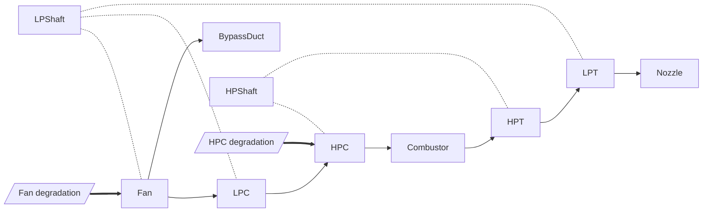

# Ontology (v0.1, draft)

Files: [`mindtwin.ttl`](../src/mindtwin/knowledge/ontology/mindtwin.ttl) (core) and
[`turbofan.ttl`](../src/mindtwin/knowledge/ontology/turbofan.ttl) (C-MAPSS engine).
Load both with `mindtwin.knowledge.ontology.load_ontology()`.

## Design principles

1. **Reuse standards.** Sensors and observed properties extend the W3C
   [SOSA](https://www.w3.org/TR/vocab-ssn/) vocabulary, so other tools can read the graph.
2. **Core vs domain.** The core ontology has no turbofan concepts; a new asset type only needs a
   new domain file.
3. **Hand-written structure, learned symptoms.** The ontology states only what the engine
   documentation tells us: modules, gas path, shafts, sensor locations, and which module each
   fault degrades. *Which sensors react to which fault* (`mt:hasSymptom`) is left empty on
   purpose: the twin learns it from data and writes it back as semantic memory. A test enforces
   this. It keeps domain knowledge and learned knowledge separate, which matters for evaluating
   RQ3 fairly.

## Core concepts

| Concept | Meaning |
|---|---|
| `mt:Asset`, `mt:Component` | The twinned system and its parts (both `sosa:FeatureOfInterest`) |
| `mt:Sensor`, `mt:ControlSignal` | Measurements and recorded set-points (`sosa:Sensor`) |
| `mt:FaultMode` | A way a component degrades |
| `mt:Event` → `Anomaly`, `MaintenanceAction`, `Prognosis` | Episodic memory |
| `mt:OperatingCondition` | Operating regime |

| Relation | From → To |
|---|---|
| `hasComponent` / `partOf` | Asset ↔ Component |
| `upstreamOf` (transitive) | Component → Component (flow order) |
| `mechanicallyCoupledTo` (symmetric) | Component ↔ Component (shafts) |
| `monitors` | Sensor → Component |
| `affects` | FaultMode → Component |
| `hasSymptom` | FaultMode → Sensor (learned) |
| `observedOn`, `concerns`, `suspectedCause`, `atCycle` | Event → … |

## Turbofan structure

Solid arrows: gas path (`upstreamOf`). Dotted: shafts (`mechanicallyCoupledTo`).
Thick arrows: fault modes (`affects`).

## Sensor locations

| Component | Sensors |
|---|---|
| Fan | s1 (T2), s5 (P2) |
| LPC | s2 (T24) |
| HPC | s3 (T30), s7 (P30), s11 (Ps30), s17 (htBleed) |
| Combustor | s12 (phi), s16 (farB) |
| HPT | s20 (W31) |
| LPT | s4 (T50), s21 (W32) |
| Bypass duct | s6 (P15), s15 (BPR) |
| LP shaft | s8 (Nf), s13 (NRf), s18 (Nf_dmd)\*, s19 (PCNfR_dmd)\* |
| HP shaft | s9 (Nc), s14 (NRc) |
| Whole engine | s10 (epr) |

\* control signals (demanded values), not physical measurements.

**Link to the data.** The sensors that lose their RUL correlation when the fan fault is added
(FD003; see [data card](data/cmapss.md)) sit on the HPC (s7), combustor (s12), bypass duct (s15),
HPT (s20) and LPT (s21). These are mostly **downstream of the fan** in the gas path, plus the bypass
duct it feeds directly. A fault's signature follows the structure, which is what the reasoning
layer will exploit.

## Open questions

- Represent sensor mapping uncertainty (e.g. bleed enthalpy is a system-level quantity)?
- Model operating conditions as individuals with their setting values?
- One graph per engine instance vs one fleet graph with shared structure (see architecture doc).
